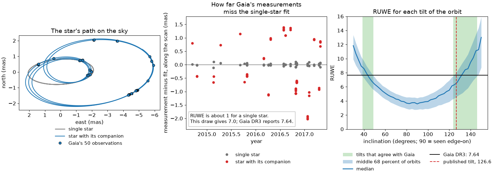
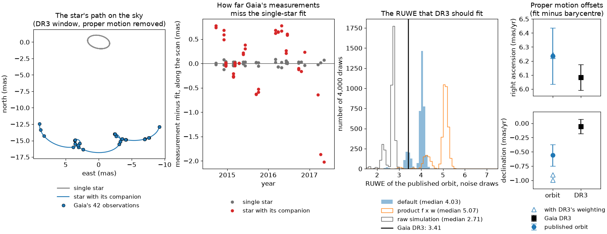

# woββler

[](https://scientific-python.org/specs/spec-0000/)

wobbler models orbital motion and its impact on Gaia astrometric solutions. It predicts the RUWE, the excess noise, the parallax and the proper motion for thousands of orbits in parallel with PyTorch. The fit follows [gaiamock](https://github.com/kareemelbadry/gaiamock), with the RUWE calibrated to Gaia DR3.

If you use wobbler, please cite gaiamock (El-Badry et al. 2024).



> Gaia BH1: the companion pulls the star off its parallax loop (left), the single-star fit misses Gaia's observations by about 1 mas (middle), and the RUWE for each tilt of the orbit (right). At the published orbit wobbler predicts a RUWE of 7.0 against Gaia's 7.64.



> Gaia BH3: Gaia DR3 saw 34 months of a 4,253-day orbit. wobbler predicts a RUWE of 4.03 against Gaia's 3.41, and the shift of the proper motion in right ascension, +6.24 against +6.08 mas/yr. In declination it predicts -0.56 against -0.06 mas/yr.

## Why

A companion pulls its star around the centre of mass of the pair. Gaia's astrometric solution fits the measured positions with the path of a single star, so part of the orbit goes into the fitted parallax and proper motion and the rest stays in the residuals, which the RUWE measures. Asking which companions a star's RUWE allows means simulating Gaia's scan and fit for many orbits and orientations. gaiamock fits one case at a time. wobbler fits them as a batch:

- **`simulate_fit`**: the calibrated RUWE, the excess noise and the fitted parallax of many orbits in the DR3 or DR2 window. With `device=None` it runs on the GPU from 700 cases a call and on the CPU below.
- **`fit_five_parameter`**: Gaia's five-parameter fit of given along-scan positions, with the proper motion, for many cases at once.
- **`Scan`**: Gaia's scan times and angles, from a GOST file, from the scanning law at a position (`Scan.from_position`, with the `gaiamock` extra) or from a Gaia source id.
- **`wobbler.light`**: orbit and mass functions in NumPy, without PyTorch.
- **`wobbler.joker`** and **`wobbler.epoch_astrometry`**: orbits from radial velocities, and a search for an astrometric orbit in along-scan positions.

For 14,400 cases of a 191-epoch scan, wobbler takes 0.034 s on 16 CPU threads and 0.008 s on the GPU in one batch, against 2.84 s for gaiamock (`benchmarks/bench.py`; the machine and versions are on the first line of each file in `benchmarks/results/`).

## Install

```text
uv pip install torch --index-url https://download.pytorch.org/whl/cpu   # rocm7.2 for AMD, cu128 for NVIDIA
uv pip install "wobbler[torch] @ git+https://github.com/mauri870/wobbler@v0.1.0"
```

Add the `gaiamock` extra for `Scan.from_position` (Gaia's scanning law at a sky position). Its unbinned mode, `simulate_fit(..., binned=False, position=(ra, dec))` with `Scan.from_position(..., binned=False)`, also needs `individual_ccds.zip` and `healpix_16_med_ruwe.npz` from the link in gaiamock's README, installed with `gaiamock-download`.

## Example

```python
import numpy as np
from wobbler import Orbit, Scan, simulate_fit

rng = np.random.default_rng(3)
scan = Scan(jd=np.sort(rng.uniform(2456891.5, 2457902.0, 70)), psi=rng.uniform(0, np.pi, 70), plx_factor=rng.uniform(-1, 1, 70))  # a synthetic scan
orbit = Orbit(period_days=185.59, ecc=0.45, t_peri_days=-1.1, omega=0.22)  # t_peri_days: days from JD 2457389.0
fit = simulate_fit(scan, orbit, a1_au=1.0, parallax_mas=np.array([2.0]), G=13.8, n_orient=300, seed=1, nu_eff=1.481)
print(np.median(fit.ruwe.numpy()))
```

More in `examples/`.

## Licence

MIT. The formulas and constants in `gaiafit.py`, `uwe_factor.py`, `scan.py` and `orbit.py` follow gaiamock's source, which is MIT-licensed (`THIRD_PARTY/gaiamock-LICENSE`). The PyPI release of gaiamock declares GPL-3.0-or-later; wobbler imports it only through the optional `gaiamock` extra, and the `test` dependency group installs it.

This work uses data from the European Space Agency mission Gaia (https://www.cosmos.esa.int/gaia), processed by the Gaia Data Processing and Analysis Consortium (DPAC).
